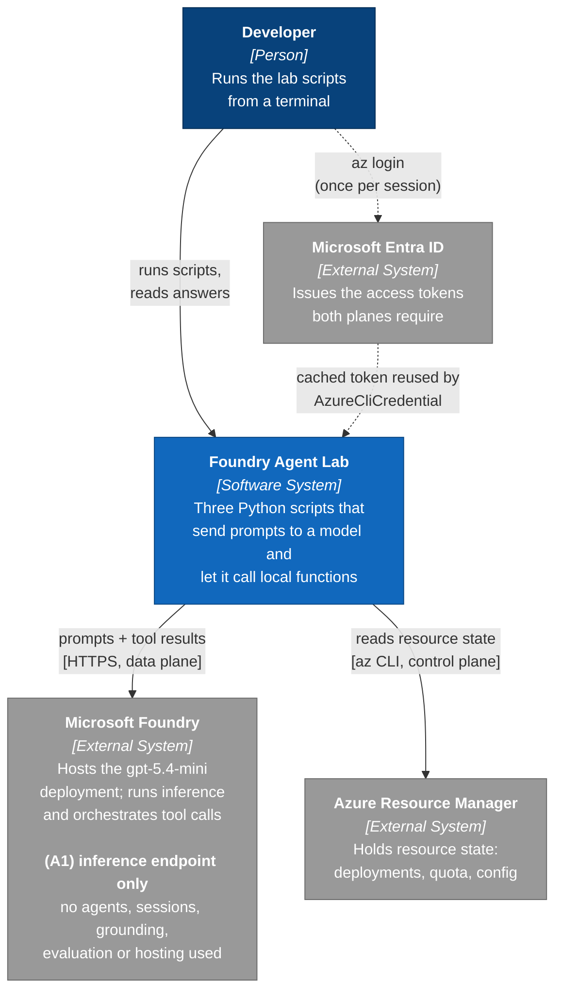
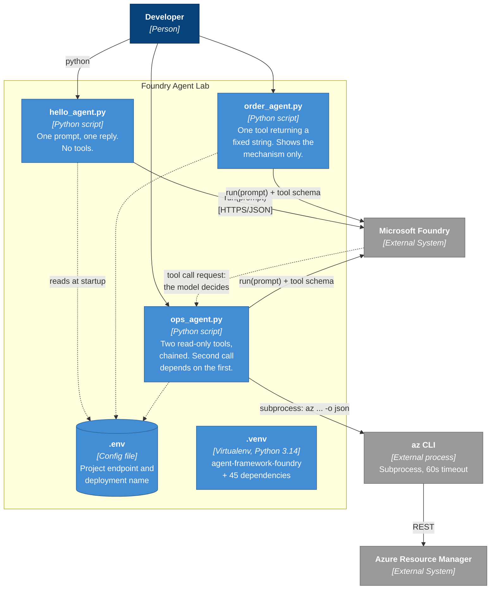
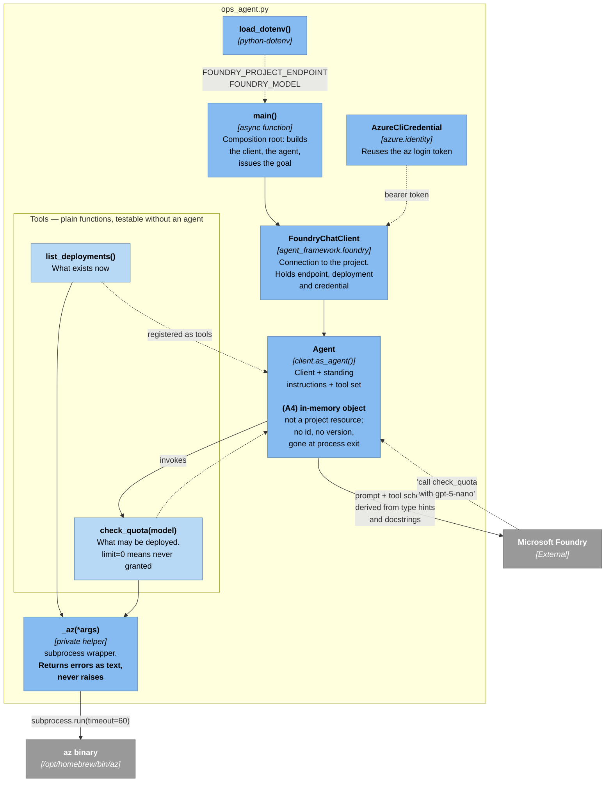
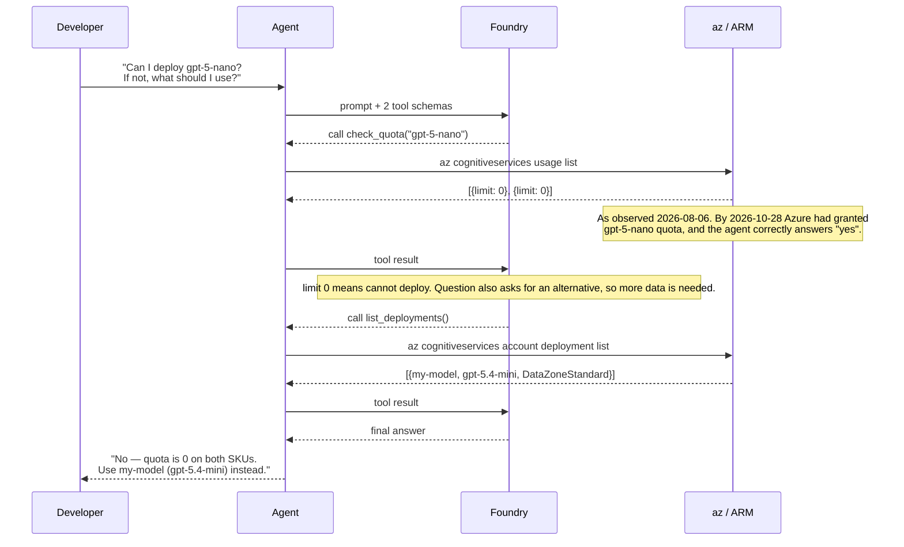
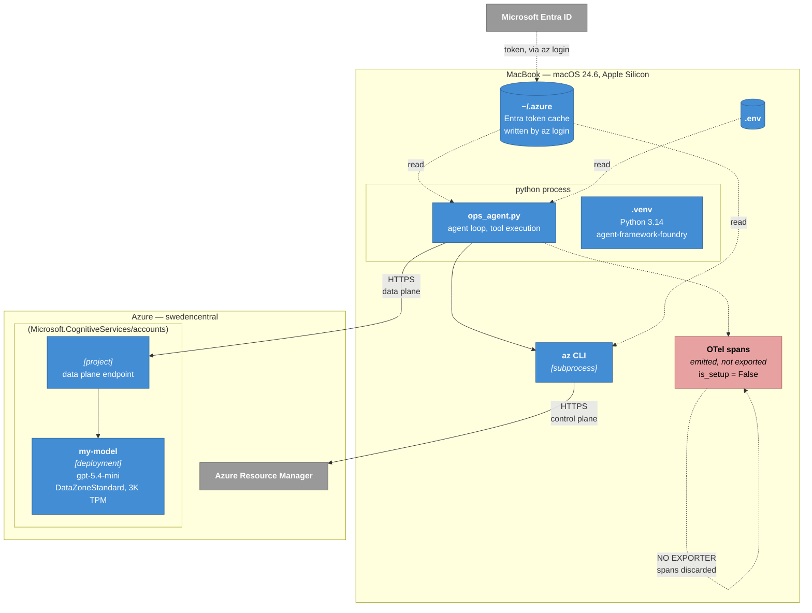

# Architecture

C4 diagrams for the Foundry agent lab, at three levels of zoom. Level 4 (Code) is
omitted — the scripts are 30-100 lines and the source is more precise than a diagram
of it would be.

The single most important structural fact about this project is that it talks to
Azure through **two independent planes with separate authorisation**:

| | Control plane | Data plane |
|---|---|---|
| Reached via | `az` CLI → Azure Resource Manager | HTTPS → project endpoint |
| Does what | create, configure, inspect resources | run inference, invoke tools |
| Authorised by | RBAC on the subscription | RBAC on the *project* (Foundry User) |

Being Subscription Owner grants nothing on the data plane. This catches almost
everyone once, and it is why `ops_agent.py` — which touches both — is the only
script here that can fail in two entirely different ways.

> ### ⚠ Read this before using these diagrams as a Foundry reference
>
> **This is not a Foundry-centric architecture.** Foundry appears in every diagram
> below as a single external box that serves completions. Everything that makes it
> a platform — server-side agents, session state, grounding, evaluation, hosting —
> is absent, and the diagrams are annotated **(A1)–(A6)** where that shows.
>
> The test: replace `agent_framework.foundry` with `agent_framework.openai` and
> every diagram below stays valid apart from the label on one box. An architecture
> where the vendor is a find-and-replace away is not built around that vendor.
>
> What this *is* a good illustration of: a local Python agent loop calling a hosted
> model, with the control-plane/data-plane split drawn honestly. Read it that way
> and it is accurate. Read it as "how to build on Foundry" and it will mislead you.
> The gap analysis at the end lists what a Foundry-centric version would move.

---

## Level 1 — System Context

Who uses this, and what it depends on.



**Elements**

| Element | Responsibility | Notes |
|---|---|---|
| Developer | Runs a script, reads the printed answer | Identified by Entra object ID, not email — directory name lookups are unreliable across tenants |
| Foundry Agent Lab | The three scripts in this repo | No server, no persistence; each run is independent |
| Microsoft Foundry | Model hosting and the agent loop | Decides *whether* to call a tool; the decision is not made locally |
| Azure Resource Manager | Source of truth for resource state | Only `ops_agent.py` reads from it |
| Microsoft Entra ID | Token issuer for both planes | `az login` writes a token cache that the Python code reuses |

**(A1)** At context level the gap is already visible: Foundry is one external box
that returns completions. A Foundry-centric system would show the agent itself
living inside that boundary as a versioned project resource, not outside it.

---

## Level 2 — Containers

What actually runs, and what carries data between the pieces.



**Elements**

| Container | Technology | Responsibility |
|---|---|---|
| `hello_agent.py` | Python 3.14, asyncio | Baseline: proves credentials, endpoint and deployment all work |
| `order_agent.py` | Python 3.14, asyncio | Demonstrates tool invocation; the tool body is a hardcoded return |
| `ops_agent.py` | Python 3.14, asyncio, subprocess | The only script that reads real system state, and the only one spanning both planes |
| `.env` | dotenv | Endpoint and deployment, plus the resource, group and region that `ops_agent.py` needs. `load_dotenv()` walks up from the **script's folder**, so the scripts run from any working directory |
| `.venv` | virtualenv | Deliberately `agent-framework-foundry`, not `agent-framework` — see below |

**(A2) Every container is a local script.** In a Foundry-centric design the agent
is not a container here at all — it is a resource in the project, and what remains
locally is a thin caller. The three boxes above would collapse to one.

**(A3) No state container exists.** There is no session store, no thread, no
memory. Each run is cold, and `.env` is the only persistent thing in the boundary.
Foundry provides `create_session()` / `create_conversation()`; the project uses
neither, so multi-turn conversation is simply not possible today.

**Dependency note.** The setup guide instructs `pip install agent-framework`. That is a
meta-package resolving to `agent-framework-core[all]`, pulling every provider Microsoft
ships — Bedrock, Gemini, Ollama, Mistral, DevUI and more. pip cannot resolve it here and
fails with `resolution-too-deep`. `agent-framework-foundry` provides the same
`agent_framework.foundry` namespace in 46 packages rather than 198.

---

## Level 3 — Components inside `ops_agent.py`

Zooming into the one container with real structure.



**Elements**

| Component | Responsibility | Design note |
|---|---|---|
| `main()` | Composition root | The only place that knows how the pieces fit together |
| `FoundryChatClient` | Transport and identity | Constructed once; carries endpoint, deployment name and credential |
| `Agent` | Client + instructions + tools | `as_agent()` also accepts `middleware`, `context_providers` and `compaction_strategy` — unused here |
| `list_deployments`, `check_quota` | The capabilities exposed to the model | Ordinary functions. Importable and runnable without spending a token |
| `_az()` | Subprocess boundary | Returns `"ERROR: ..."` instead of raising, so tool failure is a path the model can reason about rather than a crash |
| `AzureCliCredential` | Identity | Shells out to `az`, so `az` must be on `PATH` — the cause of the PyCharm failure documented in `CLAUDE.md` |

**(A4) The agent is an object, not a resource.** `as_agent()` returns a Python
value. Nothing exists in the project; nothing has an id or a version; the portal
shows no agent because there is none. `FoundryAgent(agent_name=..., agent_version=...)`
would replace this box with a connection to something that outlives the process.

**(A5) The tools are local functions and stay local.** Foundry never sees
`check_quota` execute — only a request to call it and a string coming back.
Hosted tools (`FileSearchConfig`, `FoundryToolbox`) would move capability into the
platform, where it is governed and reusable across agents. Note the trade-off: local
tools are trivially testable, which is a genuine advantage this design has.

**(A6) `AzureCliCredential` is a developer credential.** It reuses a human's
interactive `az login`. Nothing here can run unattended. A hosted agent would use
`ManagedIdentityCredential`, and the RBAC granted in setup step 8 would have to be
re-granted to that identity — a step people routinely forget.

### How the tool contract is built

The model never sees this source. It sees a schema derived from three things, which
is why they are documentation *and* interface at once:

```python
def check_quota(
    model: Annotated[str, Field(description="Model family to check, e.g. 'gpt-5-nano'")],
    #      ^^^ type            ^^^ becomes the parameter description in the schema
) -> str:
    """Check deployment quota for a model. ..."""
    #   ^^^ becomes the tool description the model reads when deciding to call it
```

Vague wording here causes the wrong tool to be called, or none. It is the
highest-leverage text in the file.

### Why this one has a loop



The second call is not scripted. It happens because the first returned `0`, and the
prompt asked for a fallback. `order_agent.py` cannot produce this shape: one question,
one lookup, done.

**What this is still not.** A single adaptive turn is not multi-step planning. There is
no goal decomposition, no state carried between runs, no action with consequences, and
so no approval gate or idempotency handling. Those need a tool that writes — a real
`deployment create` — which changes both the cost and the blast radius of running it.

---

## Deployment

C4's supplementary deployment view: which node each piece actually runs on. For this
project the answer is blunt — **everything runs on the laptop except inference.**



**What runs where**

| Node | Runs | Consequence |
|---|---|---|
| MacBook | The agent loop, every tool function, the `az` subprocess | Your code never leaves the machine. Azure sees prompts and completions, never your function bodies |
| `<foundry-resource>` | Model inference only | Billed per token. An idle deployment costs nothing |
| Entra ID | Token issuance | `az login` writes to `~/.azure`; `AzureCliCredential` reads that cache rather than prompting |

**Why the portal shows no traces.** The agent loop is on the left-hand side of that
diagram. Foundry sees individual inference requests, because it serves them — but the
sequence *around* them (which tool was chosen, what it returned, why a second call
followed) exists only in the Python process. The framework emits OpenTelemetry spans for
exactly this, but with no exporter configured they are discarded. Verify with:

```bash
python -c "from agent_framework.observability import OBSERVABILITY_SETTINGS as s; print(s.is_setup)"
# False
```

Getting them somewhere visible means configuring an exporter yourself — Application
Insights, or the local port the Foundry Toolkit VS Code extension listens on. The guide's
description of expandable run sequences in the portal applies to an agent *hosted* in
Foundry, which is its "Where to go next" item 4, not to this topology.

**What changes if the agent is hosted.** The `ops_agent.py` box moves into the Azure
boundary, and three things follow: the tools run under a managed identity instead of your
`az login` (so RBAC must be granted to that identity), `AzureCliCredential` becomes
`ManagedIdentityCredential`, and tracing starts working without setup because the loop is
now inside the platform. That last point is the real reason the guide's claim reads as
wrong here — it describes the destination, not the starting point.

---

## Gap analysis: what a Foundry-centric architecture would move

Collecting the annotations. The left column is what these diagrams show; the right
is what the same diagram would show if the architecture were built around the
platform rather than pointed at it.

| | This project | Foundry-centric |
|---|---|---|
| **A1** Foundry's role | External box returning completions | The boundary the system lives *inside* |
| **A2** Where the agent runs | A local Python process | A project resource; the local code is a thin caller |
| **A3** Conversation state | None. Every run is cold | Service-managed sessions and threads |
| **A4** Agent identity | An in-memory object, no id, no version | Named and versioned PromptAgent — instructions shippable without redeploying code |
| **A5** Tools | Local functions Azure never observes | Hosted tools, governed and shared across agents |
| **A6** Credential | `AzureCliCredential` — a human's `az login` | `ManagedIdentityCredential` — runs unattended |

Three consequences follow from the right-hand column that are not visible as boxes:

- **Tracing works without configuration.** Not a feature you switch on — a
  by-product of the loop running inside the platform. The whole reason the setup
  guide's tracing claim fails here is A2.
- **Evaluation becomes possible.** `evaluate_traces` needs traces, and traces need
  A2. Versioned agents (A4) then make "did v1.1 regress?" answerable.
- **The compliance story changes.** Under A6 the agent has its own identity with
  its own RBAC, auditable independently of any employee's account.

### What is genuinely good here, and worth keeping

The gap analysis is not an argument that this design is wrong — it is smaller, and
smaller has advantages a hosted architecture gives up:

- **Tools are testable without inference.** `cd python/local_agent && ../.venv/bin/python -c "import ops_agent; print(ops_agent.check_quota('gpt-5-nano'))"` costs nothing (C#: `dotnet run --project csharp/LocalAgent.Ops -- --tools-only`). Hosted tools cannot be exercised that cheaply.
- **The whole system is three files you can read in ten minutes.** No deployment, no identity provisioning, no cold-start.
- **The control-plane/data-plane split is drawn honestly**, and that distinction is true at any scale. It is the part of these diagrams that transfers.

Use this document to understand *the loop*. Do not use it as a template for
building on Foundry.
