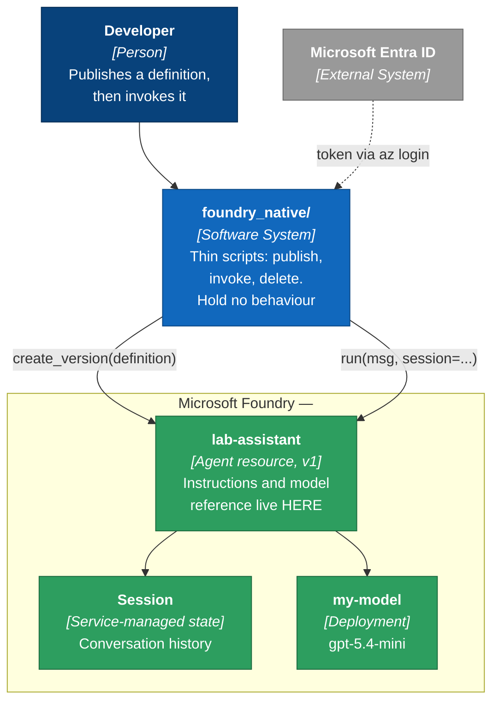
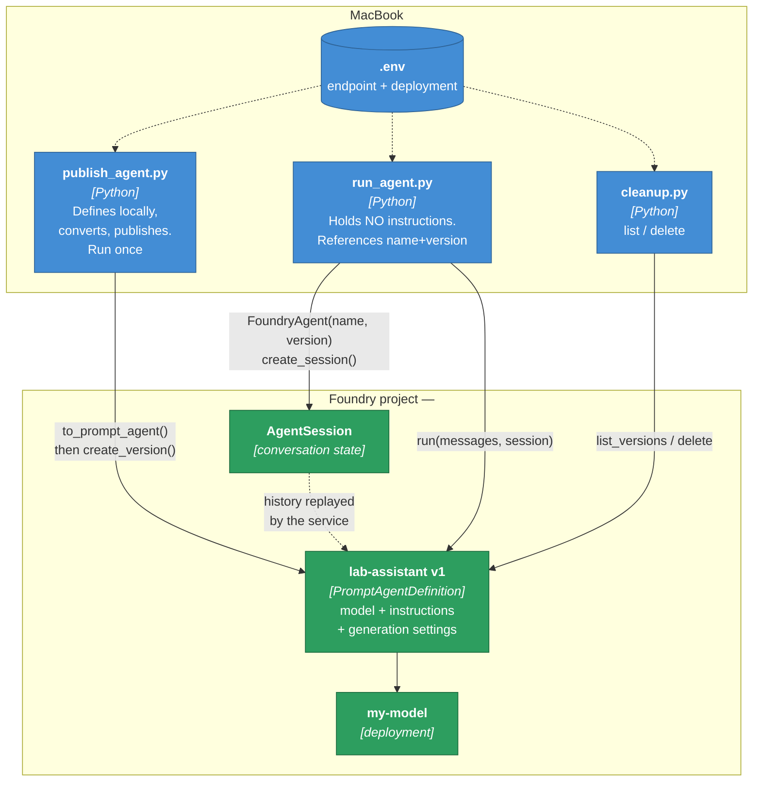
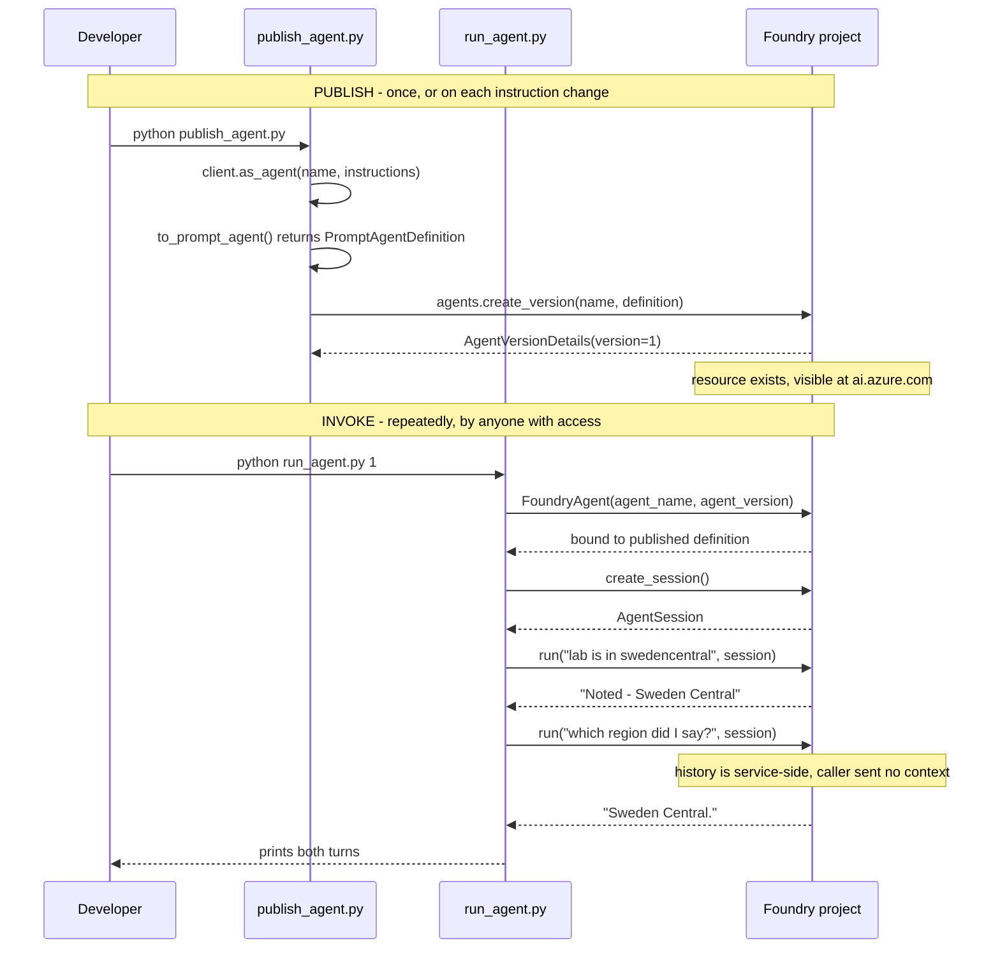
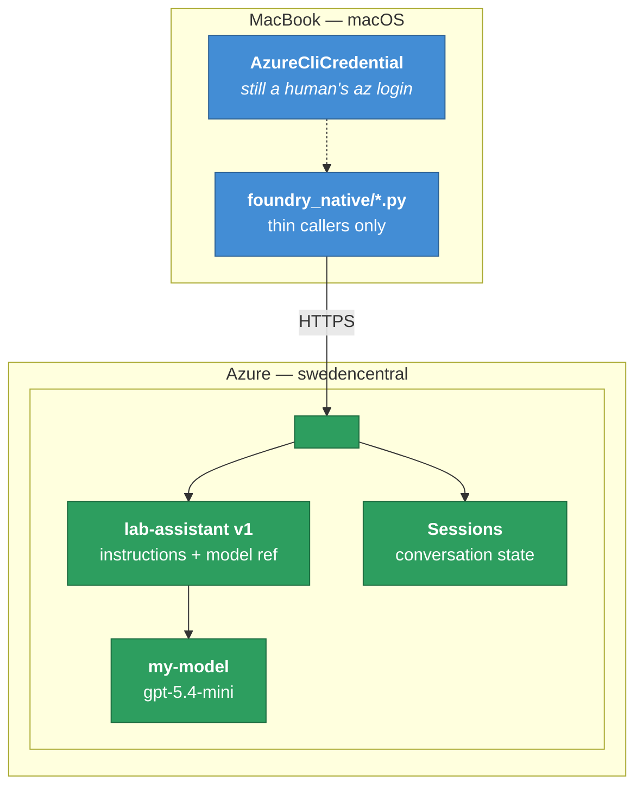

# Architecture — iteration 2, Foundry-centric

Companion to `docs/architecture.md`. Same C4 levels, same project, different
architecture. Read them side by side: the annotations **A1–A6** in the first
document are the checklist this one is measured against.

**What changed in one sentence:** the agent stopped being a Python object and
became a resource in the project, addressed by name and version.

```
iteration 1                          iteration 2
client.as_agent(...)                 FoundryAgent(agent_name="lab-assistant",
  → object, dies at exit                          agent_version="1")
                                       → reference to a published resource
```

Code lives in `python/foundry_native/`. The iteration-1 scripts remain in
`python/local_agent/`, unchanged, for comparison. The C# counterparts are the
`csharp/FoundryNative.*` and `csharp/LocalAgent.*` projects.

---

## What is deployed, and what is not

The word "deploy" covers three unrelated things here, and conflating them causes
most of the confusion:

| | Status in iteration 2 |
|---|---|
| **Model deployment** (`my-model`) | Unchanged. Reused, not duplicated. A PromptAgent references a deployment; it does not create one |
| **Agent version** | **New.** Created over the API by `publish_agent.py`. Appears in ai.azure.com, but the portal is never used to make it |
| **Hosted agent** (code, containerised) | **Not used.** That is `create_version_from_code` plus `agent-framework-foundry-hosting`. A PromptAgent is declarative — Foundry's runtime executes it, so there is no image and no endpoint to stand up |

---

## Level 1 — System Context



**The structural difference from iteration 1.** There, Foundry was one grey box on
the edge returning completions. Here it is a boundary with things inside it that
belong to the system. Instructions — the thing that determines what the agent
actually does — moved across that line.

The find-and-replace test from iteration 1 no longer passes. `agent_framework.openai`
has no equivalent of `create_version` against a project, so the vendor is now load-bearing.

---

## Level 2 — Containers



**Elements**

| Container | Responsibility | Note |
|---|---|---|
| `publish_agent.py` | Builds a local `Agent`, converts with `to_prompt_agent()`, writes it with `create_version()` | Re-running creates a *new version* rather than overwriting — which is what makes rollback possible |
| `run_agent.py` | Connects by name and version, opens a session, sends turns | Contains no instructions, no model name, no tools. Delete this file and the agent still exists |
| `cleanup.py` | Lists versions; deletes on `--delete` | Anything created should be removable in one command |
| `lab-assistant v1` | The agent itself | Editable in the portal. Change the instructions there, re-run `run_agent.py` untouched, behaviour changes |
| `AgentSession` | Conversation history | Held by the service. No local variable carries it |

---

## Level 3 — The two flows

Publishing and invoking are separate lifecycles, which is the point. The first
happens rarely, the second happens constantly.



That second turn is the observable proof. `run_agent.py` never resent the first
message, and holds no history variable.

---

## Deployment



Compare with the deployment diagram in iteration 1, where everything except
inference sat inside the laptop boundary. Here the laptop holds only credentials
and three scripts that could be deleted and rewritten in any language.

---

## Scorecard against A1–A6

| | Iteration 1 | Iteration 2 | Status |
|---|---|---|---|
| **A1** Foundry's role | Inference endpoint | A boundary containing the agent, its versions and its sessions | **resolved** |
| **A2** Where the loop runs | Entirely local | Service-side — this agent has no local tools, so nothing executes on the laptop | **resolved** |
| **A3** Conversation state | None; every run cold | `create_session()`, history held by the service | **resolved** |
| **A4** Agent identity | In-memory object | `lab-assistant`, version 1, addressable and rollback-able | **resolved** |
| **A5** Tools | Local functions Azure never sees | **No tools at all.** Sidestepped, not solved | **unresolved** |
| **A6** Credential | A human's `az login` | Still `AzureCliCredential` — the caller is a person at a terminal | **unresolved** |

### Being honest about A5

A PromptAgent's tools must be things *Foundry* can execute. `ops_agent.py`'s
`check_quota()` shells out to the local `az` binary and cannot run inside Azure.
So this iteration did not move tools server-side — it dropped them.

Three ways forward, in increasing order of effort:

1. **Hybrid.** `FoundryAgent.run()` accepts `tools=`, so local functions can be
   attached at call time to a published agent. Definition is server-side,
   execution is local. Honest and useful, but partially reopens A2.
2. **Hosted tools.** `FileSearchConfig`, `FoundryToolbox` — capability that lives
   in the platform and is shared across agents. Needs extra packages.
3. **Hosted agent.** Package the tool code and deploy it with
   `create_version_from_code`. Fully resolves A2, A5 and A6 together, and is the
   only route that makes the tools reusable by anything other than this laptop.

### Being honest about A6

The agent runs under Foundry's runtime, but *invocation* is still authorised by an
interactive `az login`. Nothing here runs unattended. That only changes with a
hosted agent or a service principal, and the RBAC granted in setup step 8 would
have to be re-granted to that identity.

---

## What is verified and what is not

Everything above was run against the live `<project>` project on 2026-08-06:

- `publish_agent.py` created `lab-assistant` version 1 — confirmed by `cleanup.py`
  listing it back
- `run_agent.py` held a two-turn session; turn 2 correctly answered "Sweden Central"
  from turn 1's context
- The delete path was exercised against a throwaway agent, so `--delete` is tested
  without having destroyed the demo

**Not verified: portal tracing.** Iteration 1's tracing failed because the loop ran
locally. That reason is gone — the loop is now service-side, so traces *should*
appear at ai.azure.com. I have not been able to confirm this, and it should be
checked before being repeated as fact.

**`to_prompt_agent` is experimental**, and says so at runtime with an
`ExperimentalWarning`. Expect this call to change.
